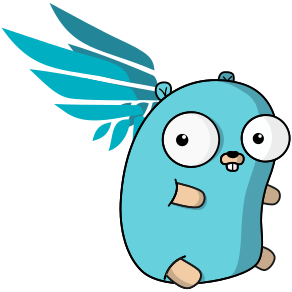

# Falcosidekick

[](https://github.com/falcosecurity/evolution/blob/main/REPOSITORIES.md#ecosystem-scope)



Falcosidekick connects [Falco](https://github.com/falcosecurity/falco) to your ecosystem. It receives Falco events over HTTP and forwards them to the outputs you configure.

This branch holds Falcosidekick v3, currently in beta. The v3 image includes a built-in web UI.

## Versions

| Version | Branch | Status | Image tags |
| --- | --- | --- | --- |
| v3 | `master` | Beta | `v3-*` |
| v2 | [`2.x`](https://github.com/falcosecurity/falcosidekick/tree/2.x) | Maintenance, security and critical fixes only | `latest`, `2.*` |

v2 configuration is not compatible with v3.

## Documentation

- [Install](docs/install.md)
- [Helm chart](docs/install.md#helm): install with `helm install --devel`, or from [`chart/falcosidekick`](chart/falcosidekick/README.md)
- [Configuration](docs/configuration.md)
- [Outputs](docs/outputs/README.md): a page per output with its settings, an example and the tested versions
- [Migrate from v2](docs/migration.md)
- [Known limits of the beta](docs/known-limits.md)

## Outputs

24 outputs: chat, alerting and on-call, logs, queues and streams, storage, observability, webhooks and response. The [outputs index](docs/outputs/README.md) lists them, with a page each.

## Build

Requires Go and [Bun](https://bun.sh).

```sh
make falcosidekick       # binary with the web UI
make falcosidekick-slim  # binary without the web UI
make image               # local image falcosidekick:local
```

## Configuration

See [`config_example_sidekick.yaml`](config_example_sidekick.yaml) for the service and [`config_example_outputs.yaml`](config_example_outputs.yaml) for outputs.

## Development

```sh
make verify
```

## License

[Apache License 2.0](LICENSE)
