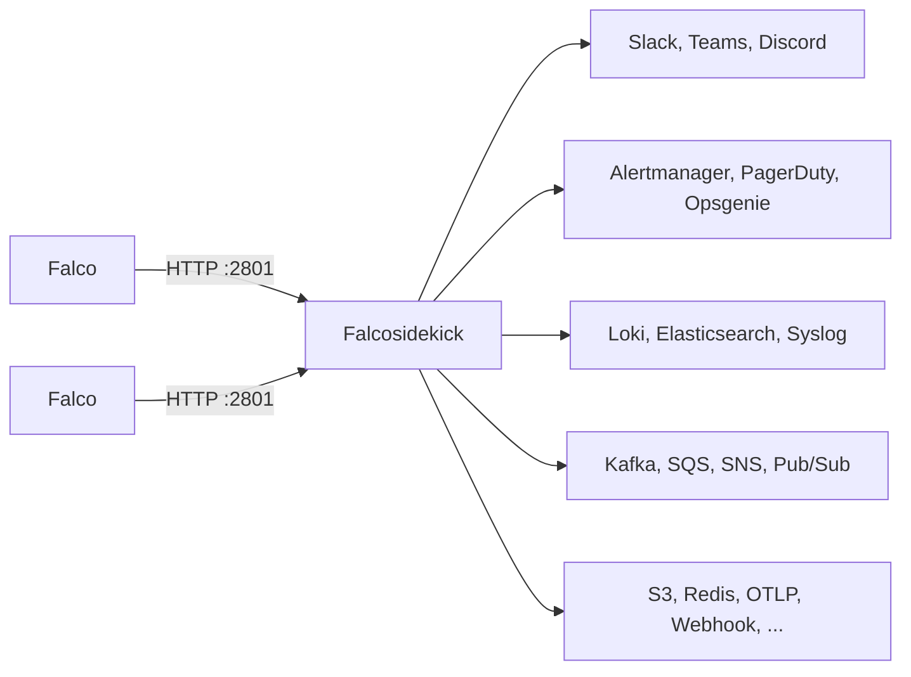
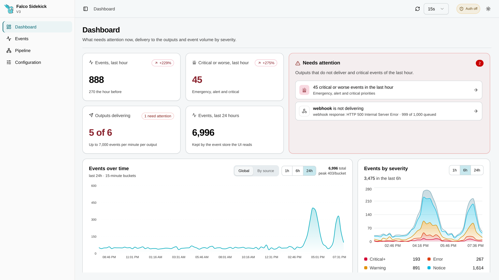
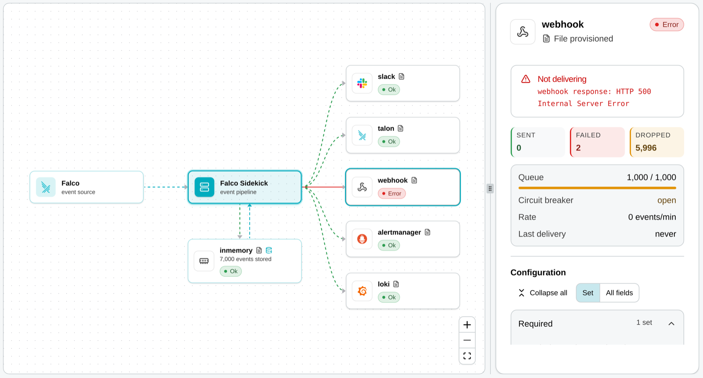
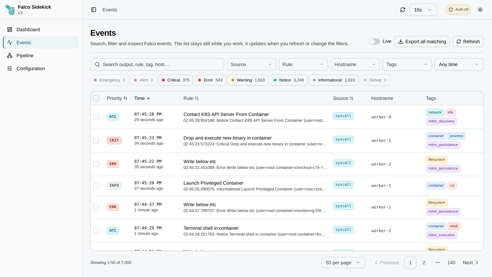

# Falcosidekick

[](https://github.com/falcosecurity/evolution/blob/main/REPOSITORIES.md#ecosystem-scope) [](https://github.com/falcosecurity/evolution/blob/main/REPOSITORIES.md#stable)
[](https://github.com/falcosecurity/falcosidekick/releases)
[](https://hub.docker.com/r/falcosecurity/falcosidekick)

[](LICENSE)


Falcosidekick connects [Falco](https://github.com/falcosecurity/falco) to your ecosystem. Falco posts its events over HTTP, and Falcosidekick forwards each one to the chat, alerting, logging, streaming and storage systems you configure, with retries, metrics and a web UI.

> [!NOTE]
> This branch is **Falcosidekick v3, in beta**. v2 is on the [`2.x`](https://github.com/falcosecurity/falcosidekick/tree/2.x) branch and its images keep the `latest` and `2.*` tags. v2 configuration is not compatible with v3: see [Migrate from v2](docs/migration.md).

## How it works



One Falcosidekick serves any number of Falco instances. Each output has its own queue, so a slow or failing destination does not delay the others.

## Features

- **Reliable delivery.** Per output: a queue, retries with backoff, a circuit breaker and optional batching. Permanent rejections are not retried, and after a partial batch failure only the events that can still be delivered are retried.
- **Configuration as files.** A core file (`-c`) and one or more output files (`-o`), with snake_case keys. Output files reload on change, on `SIGHUP` or by polling, without a restart.
- **Secrets from files.** Every secret field has a `<field>_file` variant, read from a mounted Secret.
- **Web UI and API.** Dashboard, pipeline, configuration and events pages, on a separate management listener (`127.0.0.1:2802` by default). Read-only unless `api.allow_writes` is set.
- **Persistence.** Outputs created through the API are kept in memory, sqlite or postgres, never with secret values. Postgres replicas stay in step.
- **Observability.** Prometheus metrics for every delivery outcome, `/livez` and `/readyz` probes, JSON logs.
- **Secure defaults.** Distroless image running as uid/gid 65532, signed with cosign; releases carry SLSA provenance.

## Web UI

<picture>
  <source media="(prefers-color-scheme: dark)" srcset="docs/images/ui-dashboard-dark.png">
  
</picture>

The dashboard shows what needs attention now: outputs that do not deliver and critical events. The pipeline page shows each output with its queue, circuit breaker and last error; the events page searches and filters the events the UI stores.

<table>
  <tr>
    <td width="50%">
      <picture>
        <source media="(prefers-color-scheme: dark)" srcset="docs/images/ui-pipeline-dark.png">
        
      </picture>
    </td>
    <td width="50%">
      
    </td>
  </tr>
</table>

The UI is off by default. [Install](docs/install.md#web-ui) shows how to turn it on.

## Quick start

### Helm

The v3 chart is a pre-release, so Helm installs it only with `--devel`:

```sh
helm repo add falcosecurity https://falcosecurity.github.io/charts
helm repo update
helm install falcosidekick falcosecurity/falcosidekick --devel \
  --namespace falco --create-namespace \
  --set outputs.webhook.host=http://receiver.example:8080
```

### Docker

```yaml
# outputs.yaml
outputs:
  webhook:
    host: "http://receiver.example:8080"
    endpoint: /falco
```

```sh
docker run -d --name falcosidekick -p 2801:2801 \
  -v "$PWD/outputs.yaml:/etc/falcosidekick/outputs.yaml:ro" \
  falcosecurity/falcosidekick:3.0.0-beta.1 \
  -o /etc/falcosidekick/outputs.yaml
curl -s localhost:2801/readyz
```

### Connect Falco

In `falco.yaml`:

```yaml
json_output: true
json_include_output_property: true
http_output:
  enabled: true
  url: "http://falcosidekick:2801/"
```

[Install](docs/install.md) covers the core file, Kubernetes manifests, the web UI, persistence and image verification.

## Outputs

| Category | Outputs |
| --- | --- |
| Chat | [Slack](docs/outputs/slack.md), [Microsoft Teams](docs/outputs/teams.md), [Discord](docs/outputs/discord.md) |
| Alerting and on-call | [Alertmanager](docs/outputs/alertmanager.md), [PagerDuty](docs/outputs/pagerduty.md), [Opsgenie](docs/outputs/opsgenie.md), [Grafana OnCall](docs/outputs/grafanaoncall.md), [Datadog](docs/outputs/datadog.md) |
| Logs | [Loki](docs/outputs/loki.md), [Elasticsearch](docs/outputs/elasticsearch.md), [Syslog](docs/outputs/syslog.md) |
| Queues and streams | [Apache Kafka](docs/outputs/kafka.md), [Amazon SQS](docs/outputs/awssqs.md), [Amazon SNS](docs/outputs/awssns.md), [Google Pub/Sub](docs/outputs/gcppubsub.md) |
| Storage | [Amazon S3](docs/outputs/awss3.md), [Redis](docs/outputs/redis.md), [In-memory store](docs/outputs/inmemory.md) |
| Observability | [OpenTelemetry (OTLP)](docs/outputs/otlp.md) |
| Email | [SMTP](docs/outputs/smtp.md) |
| Webhooks | [Webhook](docs/outputs/webhook.md), [CloudEvents](docs/outputs/cloudevents.md) |
| Response | [Falco Talon](docs/outputs/talon.md) |
| Other | [Policy Report](docs/outputs/policyreport.md) |

Each page has the settings, an example and the tested versions. Settings shared by several outputs are in [common settings](docs/outputs/common.md).

## Ports and endpoints

| Port | Default address | Serves |
| --- | --- | --- |
| 2801 | all interfaces, IPv4 and IPv6 | Falco events (`POST /`), `/livez`, `/readyz`, `/metrics` |
| 2802 | `127.0.0.1` | API and web UI. The API has no authentication: expose it only to trusted clients. |

## Versions and images

| Version | Branch | Status | Image tags |
| --- | --- | --- | --- |
| v3 | `master` | Beta | `3.*` releases, `v3-main` builds of `master`; `-slim` variants without the UI |
| v2 | [`2.x`](https://github.com/falcosecurity/falcosidekick/tree/2.x) | Maintenance, security and critical fixes only | `latest`, `2.*` |

Images are published to Docker Hub. [Install](docs/install.md#images) lists every tag and how to verify the signatures.

## Documentation

- [Install](docs/install.md): container, Helm, Kubernetes, web UI, persistence
- [Configuration](docs/configuration.md): every key of the core file
- [Outputs](docs/outputs/README.md): one page per output
- [Helm chart](chart/falcosidekick/README.md): every chart value
- [Migrate from v2](docs/migration.md)
- [Known limits of the beta](docs/known-limits.md)

## Build from source

Requires Go and [Bun](https://bun.sh).

```sh
make falcosidekick       # binary with the web UI
make falcosidekick-slim  # binary without the web UI
make image               # local image falcosidekick:local
make verify              # the checks CI runs
```

## Contributing

Issues and pull requests are welcome; see the Falco [contributing guidelines](https://github.com/falcosecurity/.github/blob/main/CONTRIBUTING.md). v2 fixes go to the `2.x` branch. Talk to the community in the `#falco` channel of the [Kubernetes Slack](https://kubernetes.slack.com/messages/falco).

## License

[Apache License 2.0](LICENSE)
